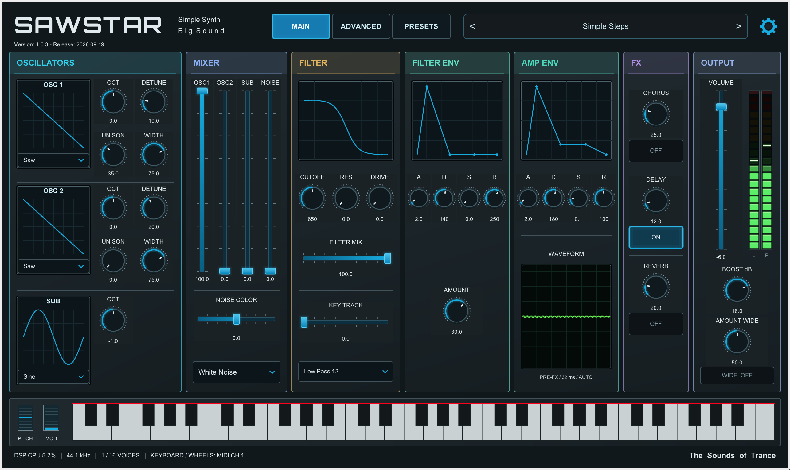
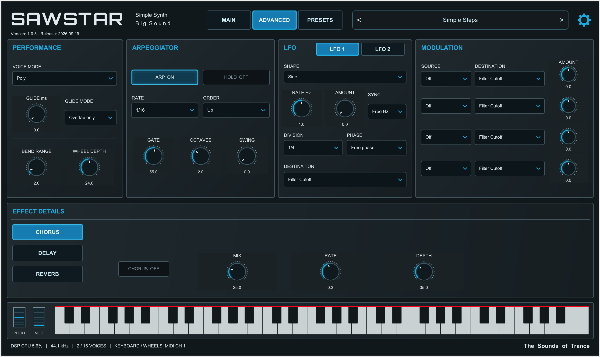
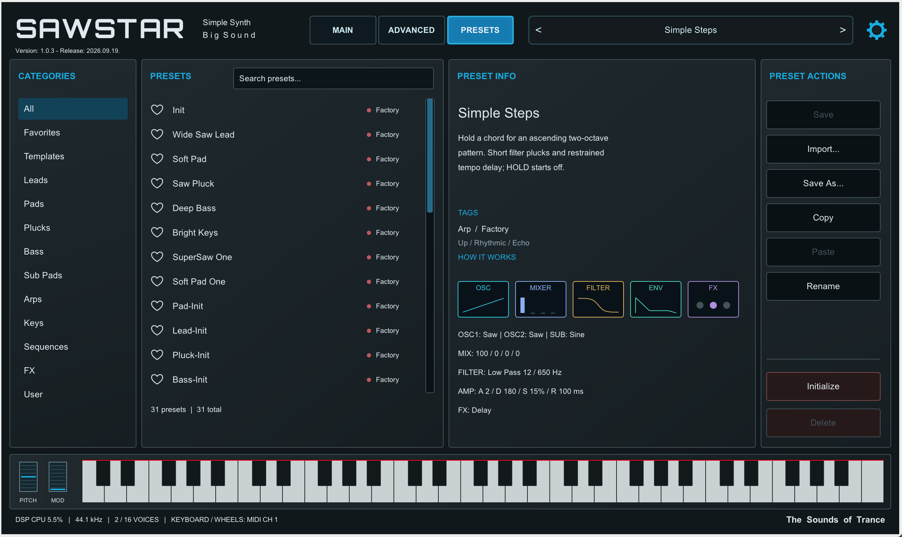

# SAWSTAR

**Simple Synth - Big Sound**

The Sounds of Trance.

An open-source VST3 synthesizer for approachable leads, pads and plucks, with
clear signal flow and a preset browser that explains saved sounds.

**SAWSTAR 1.2.0** uses the calibrated Premium LP12/LP24/HP12/BP12 filters,
32-sample latency and 30 built-in factory presets. The About window includes
the vector creator signature. [Release notes](docs/RELEASE_NOTES_1.2.0.md).

*Real SAWSTAR 1.0.3 screenshots captured in REAPER, supplied by RobCZart82
(build `8040390`). The displayed preset count includes user-library entries alongside factory presets. The current development bank contains 30 factory presets (24 original and six new performance sounds).*

## Download

Download the **latest published SAWSTAR release** from [GitHub Releases](https://github.com/RobCZart82/SAWSTAR/releases/latest).
The version marked **Latest** there is the public download version.

Download Windows and macOS installers or manual-install archives from
[the 1.2.0 release](https://github.com/RobCZart82/SAWSTAR/releases/tag/v1.2.0).
Later development on `main` may differ from the released packages.

**Recommended installers:** Windows x64 / ARM64 Setup EXE, or macOS Universal
DMG containing the PKG installer. **Manual installation:** separate VST3 ZIPs
are available for each target. All packages include English/Hungarian PDF guides
and license notices. The installers are unsigned; read the installation guide
before proceeding through platform security prompts.

See the [1.2.0 release notes](docs/RELEASE_NOTES_1.2.0.md) for the current public packages.
The [1.2.1 stable build is being prepared](docs/RELEASE_1.2.1_CHECKLIST.md); it is not yet published.

## Features

- Two waveform oscillators with 7-layer unison, SUB oscillator, White/Pink/Dark
  noise and independent Noise Color.
- Four-source mixer, filter modes/drive, amp and filter ADSR envelopes.
- Poly/Mono/Legato, glide, pitch/mod wheels, two LFOs and four modulation routes.
- Arpeggiator, chorus, delay, reverb and master stereo width.
- 30 embedded presets: seven Templates, 17 original finished sounds and six performance sounds.
- User .sawstar files, batch import, favorites, safe Save/Save As and recovery.
- MAIN, ADVANCED and PRESETS pages, pre-FX scope, output meter and DSP CPU display.

## System requirements

VST3 host and graphics driver required. Build targets are Windows x64, Windows
ARM64 and macOS Universal (Intel + Apple Silicon). Build minimums
are distinct from verified support: see [System requirements](docs/SYSTEM_REQUIREMENTS.md).
Users do not need Visual Studio, CMake, Git, a compiler or the VST3 SDK.

## Installation

Use a matching installer or copy the full VST3 bundle manually.
Close the host before updating and preserve your user presets.
See [Installation](docs/INSTALLATION.md) for locations, architecture matching,
unsigned-package status and avoiding duplicate macOS installations.

## Documentation

- [User guide index](docs/USER_MANUAL.md)
- [English PDF](docs/manuals/SAWSTAR-User-Manual-EN.pdf)
- [Magyar PDF](docs/manuals/SAWSTAR-User-Manual-HU.pdf)
- [Factory library](docs/FACTORY_LIBRARY.md)
- [Changelog](CHANGELOG.md) and [1.2.0 release notes](docs/RELEASE_NOTES_1.2.0.md)
- [1.0.4 publication record and historical checklist](docs/RELEASE_1.0.4_CHECKLIST.md)
- [1.2.0 publication record and historical checklist](docs/RELEASE_1.2.0_CHECKLIST.md)
- [Development documentation index and current status](docs/DEVELOPMENT_DOCUMENTATION_INDEX.md)
- [Consolidated bugfix and validation plan, 2026-10-20](docs/BUGFIX_DEVELOPMENT_PLAN_2026_10_20.md)
- [Next release plan and real REAPER CPU acceptance](docs/NEXT_RELEASE_DEVELOPMENT_PLAN.md)
- [Current development order and open release gates](docs/DEVELOPMENT_ROADMAP.md)
- [Historical development log and measurement evidence](docs/DEVELOPMENT_PLAN_POST_1.0.4.md)
- [Repository review, 2026-10-09](docs/REPOSITORY_REVIEW_2026_10_09.md)
- [Repository review and release readiness, 2026-10-02](docs/REPOSITORY_REVIEW_2026_10_02.md)

The English and Hungarian guides on this branch describe the prepared 1.2.1
stable build and include version-labelled 1.0.3 screenshots. A metadata date
does not establish publication. The assets
already published for 1.2.0 are unchanged.

## Building from source

Read [Building](docs/BUILDING.md) for toolchain and pinned dependency setup.
Development prerequisites are not end-user prerequisites.
[Contributing](CONTRIBUTING.md) describes how to report bugs and propose changes.
Historical implementation notes are indexed by the [development history](docs/DEVELOPMENT_HISTORY.md).

## About

The About window identifies the creator with the vector signature and GYR mark.

*Actual SAWSTAR 1.0.3 About window, capture build `8040390`.*

## License

Original SAWSTAR code: [MIT](LICENSE). External components retain their own
terms; see [Third-party notices](THIRD_PARTY_NOTICES.md). Creator branding has
separate treatment and is not granted for unrestricted reuse by the code license.

### Release history and next maintenance target

Version 1.0.4 was published on October 2, 2026. It includes MIDI/editor lifecycle, envelope precision,
VST3 tail and preset-validation fixes. Parameter IDs, state compatibility and
GUI layout remain unchanged. See [1.0.4 changes](docs/RELEASE_NOTES_1.0.4.md)
and [release validation](docs/RELEASE_1.0.4_CHECKLIST.md).

The current public release is [1.2.0](https://github.com/RobCZart82/SAWSTAR/releases/tag/v1.2.0),
published on November 7, 2026. The [1.2.1 maintenance plan](docs/RELEASE_1.2.1_PLAN.md)
tracks repository fixes and required validation; it is not a release, download,
or publication announcement. A build-metadata date is not evidence that a
release has been published.

